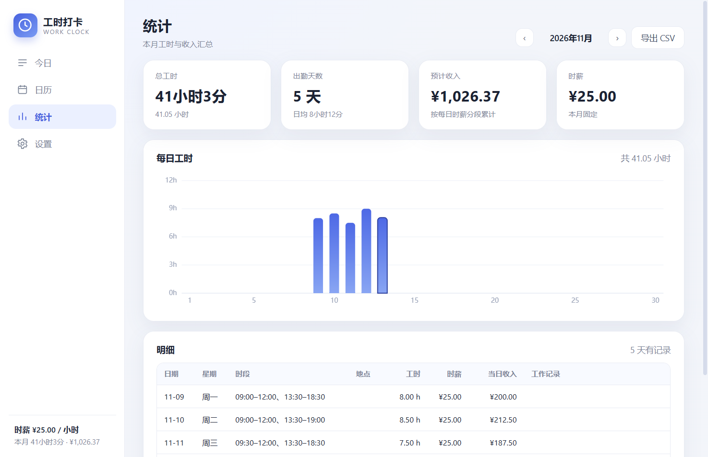

# 工时打卡 Work Clock


一个离线的 Windows 桌面打卡工具：每天上下班打卡，自动累计本月工时，并按时薪算出本月预计收入。数据只保存在本机，不联网、不需要账号。

| 今日                                 | 日历                                    |
| ---------------------------------- | ------------------------------------- |
|  |  |
| **统计**                             | **设置**                                |
|  |  |

## 功能

- **自定义安装与数据目录**：安装向导支持自由选择程序安装位置与本地数据存放路径，支持一键导入旧版本打卡记录，卸载时可选择保留个人数据。
- **今日**：一键上班 / 下班打卡，实时显示今日工时与预计收入；打卡时间按半点刻度 ±10 分钟归集，范围外由你选时间点，且不影响下班打卡；漏打卡可手动补录，支持跨零点时段。
- **工作记录与地点**：每天一段工作记录 + 上班地点，地点输入框会自动联想最近用过的地点。
- **日历**：按月查看每天的工时与收入，点击任意日期可查看当天所有时段、地点和工作记录。
- **统计**：汇总本月总工时、出勤天数、日均工时与预计收入，提供每日工时柱状图与明细表（支持导出 UTF-8 BOM CSV）。
- **时薪管理**：按生效日期分段设置时薪；涨薪时新增一条带生效日期的记录，历史月份金额保持不变。
- **数据安全**：每次保存自动留上一版备份，每天首次写入自动归档（保留最近 14 份）；主数据损坏时自动回退到备份；支持导出 / 导入 JSON 与恢复历史备份。
- **设置分组与托盘常驻**：设置页按「时薪 / 数据 / 窗口」分组折叠，收起时自动显示当前状态摘要；点窗口右上角 × 默认隐藏到任务栏托盘，左键恢复窗口，右键菜单可「退出」。

## 环境要求

- **操作系统**：Windows 10 / 11（64 位）
- **使用**：直接运行安装包或解压绿色版即可，不需要安装 Node.js，也不需要联网。

## 安装包说明与快速开始

从 [Releases](https://github.com/Fanghonglai/WorkClock/releases) 下载适合自己的版本：

| 安装包 | 适用场景 | 使用方式 |
| --- | --- | --- |
| `WorkClock-1.1.0-Setup.exe` | **安装版（推荐日常使用）** | 双击运行安装向导，可自选安装目录和数据目录，支持从旧版数据目录导入，在控制面板可标准卸载。 |
| `WorkClock-1.1.0-win-x64.zip` | **绿色免安装版** | 完整解压到任意目录，双击 `工时打卡.exe` 运行；数据默认保存在程序同级的 `data` 文件夹。 |

### 上手步骤

1. 第一次打开会提示「先设置你的时薪」，填上时薪（元/小时）和生效日期并保存。
2. 上班时点「上班打卡」，下班时点「下班打卡」；忘了打卡可在今日页或日历页点「补录时段」。
3. 月底打开「统计」页查看本月汇总，需要留档或做表可点「导出 CSV」。

### 升级方式

- **安装版**：退出正在运行的程序，直接运行新版 `Setup.exe`，向导会自动读取上次的安装目录与数据目录，一路下一步即可覆盖升级，历史记录原样保留。
- **绿色版**：把新版 zip 解压到新目录，并将旧目录下的 `data` 文件夹复制过去（或通过 `workclock.config.json` 指向旧数据目录）。

## 一个完整的工作日

1. **设置时薪**（只需一次）：设置页 → 填时薪与生效日期 → 保存。
2. **上班打卡**：今日页点「上班打卡」，下方出现进行中的时段并每秒刷新；落在半点刻度前后 10 分钟内自动归到该刻度，落在范围外则弹出「这次打卡记在几点？」供选择本次打卡时间点，时段继续计时。
3. **记录工作内容**：在「工作记录」卡片填写地点与工作内容，停止输入或失焦后自动保存。
4. **下班打卡**：点「下班打卡」，当天工时定稿。
5. **补录与修改**：漏打卡可点「补录时段」（跨零点勾选「次日结束」）；已记录的时段可在列表里直接编辑或删除。
6. **查看与导出**：统计页确认本月工时与收入，点「导出 CSV」可直接用 Excel / WPS 打开。

## 计算规则

- 工时归到**打卡开始那天**；跨零点时段计入开始日（例如 22:00 到次日 01:30 记在开始日）。
- 一天支持多段打卡；进行中的时段按**真实当前时间**实时计入。
- **半点刻度 ±10 分钟归集**：全天 48 个刻度（`HH:00` 与 `HH:30`），打卡时刻截断到分钟（秒不参与）。落在某个刻度前后各 10 分钟内（两端都含）归为该刻度（如 `09:08 → 09:00`、`09:20 → 09:30`、`23:55 → 次日 00:00`）；落在空档（`HH:11–HH:19`、`HH:41–HH:49`）内会先按实际分钟记录并弹窗由你选择本次时间点，不猜测、不影响另一端。
- **补录与编辑**：同样遵循「窗口内归刻度、窗口外按填写值」规则；编辑进行中记录时下班时间默认留空，留空保存只修改上班时间、不会结束时段。
- **时薪与金额**：某天使用「生效日期 ≤ 当天」的最新一条时薪（早于最早记录则取最早一条）；当日收入 = 该段毫秒数 ÷ 3600000 × 当天时薪，月总额汇总各天金额后四舍五入到分。

## 数据、备份与迁移

程序优先读取可执行文件同目录下 `workclock.config.json` 中的 `dataDir`；未配置时默认使用同级 `data` 目录（若目录不可写则回退到 `%APPDATA%\work-clock`）。数据目录内文件如下：

| 文件 | 说明 |
| --- | --- |
| `data.json` | 当前数据（打卡记录、时薪、工作记录、地点、窗口位置与设置） |
| `data.bak.json` | 上一次保存前的自动备份 |
| `backups\data-YYYYMMDD.json` | 每天首次写入时归档，保留最近 14 份 |

- 启动时若 `data.json` 无法读取，会自动按 `data.bak.json` → 最近每日备份的顺序回退，并在顶部提示。
- 换电脑可在设置页「导出备份」生成 JSON 文件，在新机器上「导入备份」恢复。

## 代码结构

```text
WorkClock/
├─ package.json            # 项目信息、依赖与 electron-builder 配置
├─ CHANGELOG.md            # 版本更新记录
├─ README.md               # 项目说明
├─ LICENSE                 # MIT 许可证
├─ build/
│  └─ icon.png             # 应用与安装包图标
├─ src/
│  ├─ main/
│  │  ├─ main.js           # Electron 主进程：窗口管理、托盘、IPC 与文件导出
│  │  └─ store.js          # 数据持久化：读写、校验、去重、自动备份与损坏恢复
│  ├─ preload.js           # contextBridge 安全桥接主进程与渲染进程 API
│  ├─ shared/
│  │  └─ calc.js           # 核心计算模块：半点归集、工时统计、分段时薪与格式化
│  └─ renderer/
│     ├─ index.html        # 页面结构（今日 / 日历 / 统计 / 设置）
│     ├─ styles.css        # 界面样式与窄窗口自适应布局
│     └─ app.js            # 前端交互、图表绘制与状态渲染
├─ installer/
│  ├─ Common.cs            # 安装/卸载共享常量与版本号定义
│  ├─ Setup.cs             # 原生 Windows 安装向导（自选目录、旧数据导入）
│  ├─ Uninstall.cs         # 卸载程序（支持保留个人数据）
│  └─ app.manifest         # Windows 程序清单
├─ asar.ps1                # asar 打包/解包脚本
├─ build-installer.ps1     # 构建 Setup.exe 与免安装 zip 资产脚本
├─ test/
│  ├─ calc.test.js         # 核心计算单元测试
│  └─ store.test.js        # 数据层单元测试
└─ docs/screenshots/       # 界面截图
```

## 常见问题

- **双击 exe 没反应**：绿色版需先完整解压再运行，不要在压缩包预览窗口里直接双击；若仍被拦截，请检查杀毒软件是否误报。
- **点了 × 程序还在运行**：默认开启了「关闭窗口时最小化到托盘」；如需直接退出，右键任务栏托盘图标选「退出」，或在设置页「窗口」分组里关闭该开关。
- **改了时薪，上个月金额变了**：说明直接修改或删除了历史生效的时薪；涨薪请新增一条并设置新的生效日期，历史月份就不会受影响。
- **跨零点的班怎么记**：正常打卡即可，工时算在开始那天；补录时勾选「次日结束」。
- **打卡时弹出「这次打卡记在几点？」**：说明打卡时刻落在半点刻度 ±10 分钟之外，选一个刻度或手填时间即可；直接取消也会按实际打卡分钟保留，不会中断计时。

## 版本与许可

- 当前版本 **1.1.0**，完整变更记录见 [CHANGELOG.md](CHANGELOG.md)。
- 遇到问题或有建议欢迎提 [GitHub Issue](https://github.com/Fanghonglai/WorkClock/issues)。
- [MIT License](LICENSE) © 2026 Fanghonglai
